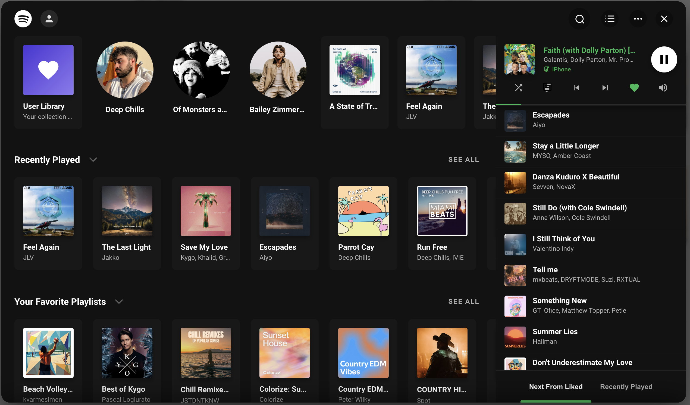
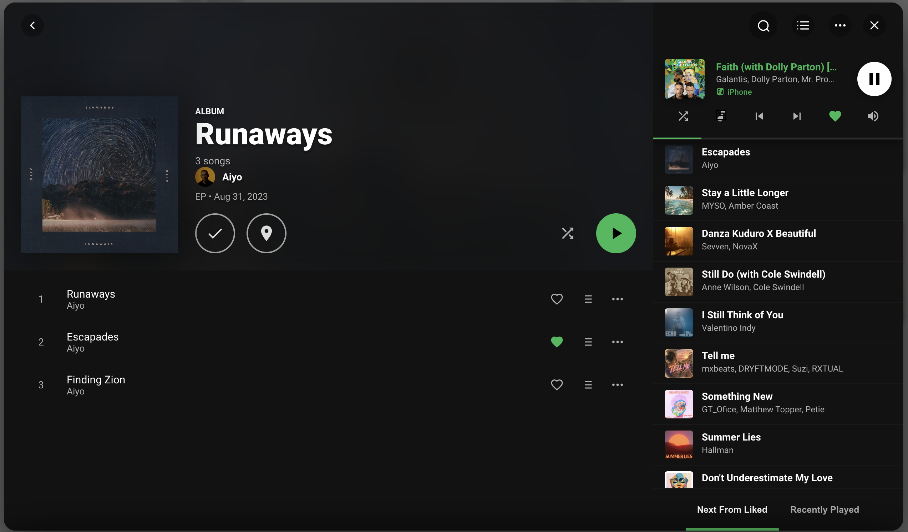
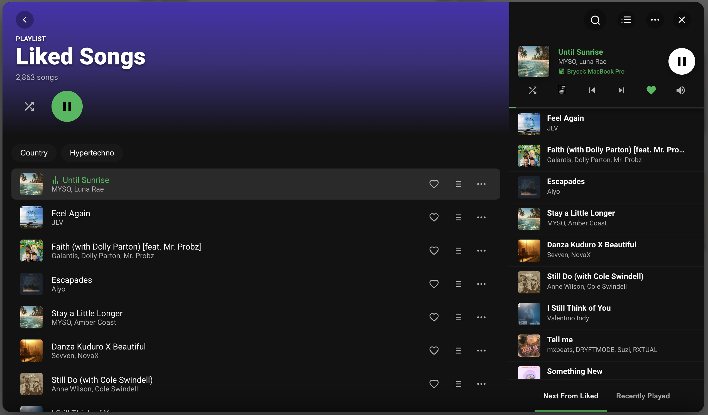
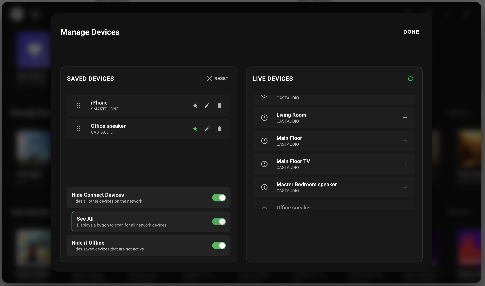
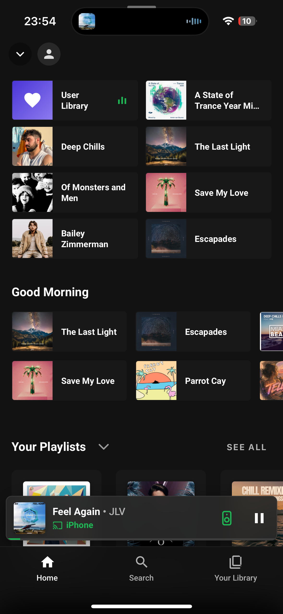
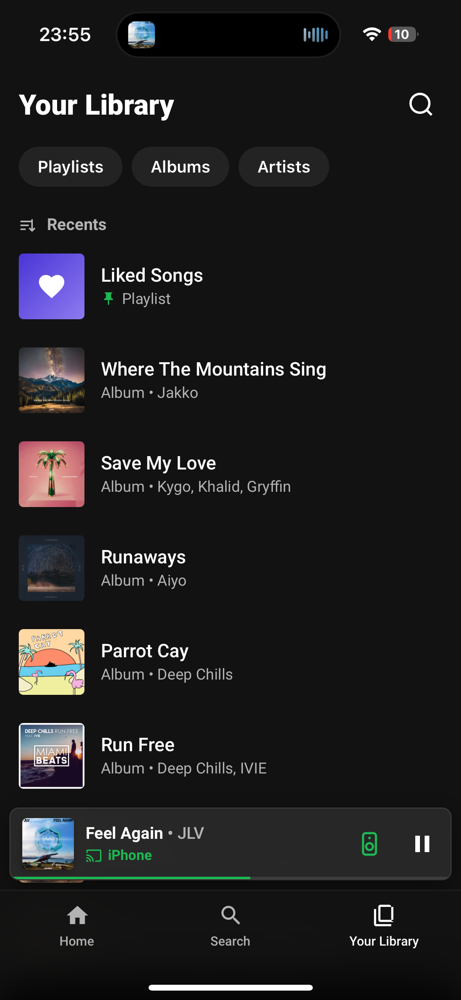
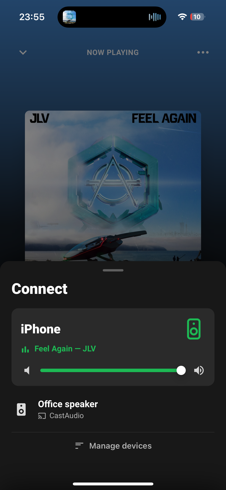
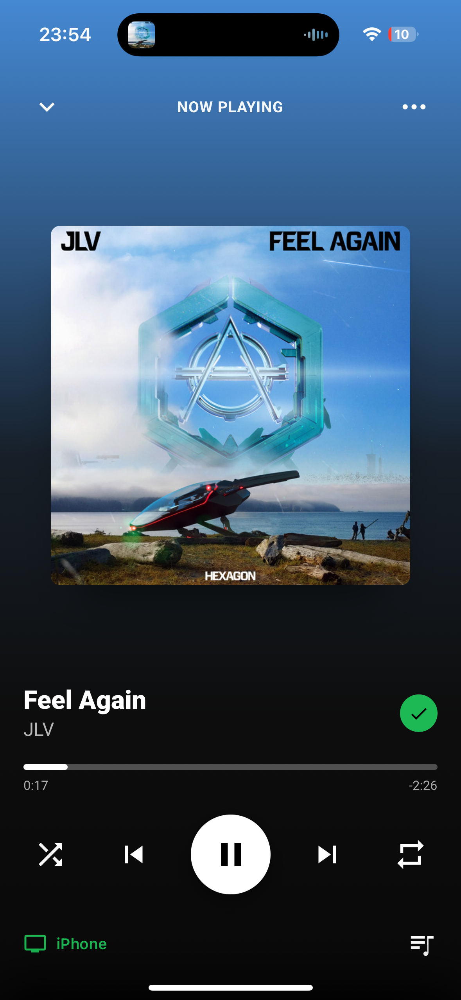

# Spotify Browser Card

A full-screen Spotify browser for Home Assistant dashboards. Browse your library, search, manage playlists, control playback and devices. Styled after the Spotify app on desktop and mobile.

> [!IMPORTANT]
> Requires the [SpotifyPlus](https://github.com/thlucas1/homeassistantcomponent_spotifyplus) integration, **v1.0.200 or newer** for playlist management.

## Preview

### Desktop
<p align="center">
  
  
</p>
<p align="center">
  
  
</p>

### Mobile
<p align="center">
  
  
  
  
</p>

## 1. Install

### HACS (recommended)

1. Open **HACS** in Home Assistant.
2. Menu (⋮) → **Custom repositories**.
3. Add `https://github.com/BWilky/HA-Spotify-Browser`, category **Lovelace**.
4. Install **Spotify Browser**. HACS registers the dashboard resource for you.

### Manual

1. Download `spotify-browser.js` from the [latest release](https://github.com/BWilky/HA-Spotify-Browser/releases).
2. Copy it to your Home Assistant `www/` folder.
3. Add the resource to your dashboard:

```yaml
resources:
  - url: /local/spotify-browser.js
    type: module
```

## 2. Get it running

Two ways. **Dashboard root is the better one**: the browser isn't tied to a card, so you can open it from anywhere on the dashboard.

### Dashboard root (recommended)

Dashboard menu (⋮) → **Edit dashboard** → ⋮ → **Raw configuration editor**. Add this at the top:

```yaml
spotify_browser:
  entity: media_player.spotifyplus_yourname
```

That loads the browser on every tab. Open it by navigating to a URL hash (next section), from as many places as you like: a button card, a picture element, a tap action on a media player card, an automation.

### Place a card

If you just want a tile to tap, add the card to a view:

```yaml
type: custom:spotify-browser-card
entity: media_player.spotifyplus_yourname
```

That's the whole minimal config. The card renders a launch tile that follows your theme and resizes in sections view. Change its text, icon and color under `card:`:

```yaml
type: custom:spotify-browser-card
entity: media_player.spotifyplus_yourname
card:
  title: Spotify Browser   # default
  label: launch            # default
  icon: mdi:spotify        # default
  color: green             # theme token (green/primary/…) or hex like "#1DB954"
```

## 3. Launch the browser

Anything that navigates to a URL hash opens it:

* `#spotify-browser` — open the browser
* `#spotify-browser-now-playing` — open straight to Now Playing (mobile)
* `#user-a` — open and switch to that account (from `accounts[].hash`)

Button card example:

```yaml
type: button
icon: mdi:spotify
tap_action:
  action: navigate
  navigation_path: "#spotify-browser"
```

From JavaScript:

```javascript
window.dispatchEvent(new CustomEvent('spotify-browser-open'));
window.dispatchEvent(new CustomEvent('spotify-browser-open-now-playing'));
```

## 4. Storage (pins and device settings)

Pinned home items and device settings are saved in a template sensor. Without it the card still works, you just can't pin things or save device settings.

### Sensor: add to `configuration.yaml`

```yaml
template:
  - trigger:
      - platform: event
        event_type: spotify_browser_store_data
    sensor:
      - name: Spotify Browser Data
        unique_id: spotify_browser_data
        state: "{{ now().timestamp() | int }}"
        attributes:
          data: "{{ trigger.event.data.data }}"
```

### Script: add to `scripts.yaml` (only for non-admin users)

Admins write to the sensor directly. Non-admin users (guest accounts, wall tablets, family phones) can't fire events, so this script does it for them:

```yaml
spotify_browser_store:
  alias: Spotify Browser Store
  mode: queued
  fields:
    data:
      description: Full data object to persist
  sequence:
    - condition: template
      value_template: "{{ data is mapping }}"
    - event: spotify_browser_store_data
      event_data:
        data: "{{ data }}"
```

### Point the card at them

```yaml
storage:
  sensor: sensor.spotify_browser_data
  event: spotify_browser_store_data
  script: spotify_browser_store
```

The sensor and event names above are the defaults, so with those names you only need `storage.script`, and only if non-admins will pin things. Restart HA (or reload template entities and scripts), then turn on pins with `home: {pinned: true}`.

## 5. Set up with an AI assistant

If you use an AI assistant that can edit your Home Assistant config (Claude with the HA MCP server, for example), paste this in. It covers the whole install.

```text
Set up the Spotify Browser card (https://github.com/BWilky/HA-Spotify-Browser) in my Home Assistant.

1. Confirm the SpotifyPlus integration is installed and tell me the media_player entity id(s) it created (they look like media_player.spotifyplus_<name>). If it isn't installed, stop and tell me; it must be added through HACS and Settings > Devices & Services first.

2. Install the card through HACS: add https://github.com/BWilky/HA-Spotify-Browser as a custom repository (category Lovelace) and install "Spotify Browser". Confirm the dashboard resource /hacsfiles/HA-Spotify-Browser/spotify-browser.js exists. If HACS isn't available, download spotify-browser.js from the latest GitHub release into /config/www/ and register /local/spotify-browser.js as a module resource.

3. Add this template sensor to configuration.yaml (merge into an existing template: block if there is one):

template:
  - trigger:
      - platform: event
        event_type: spotify_browser_store_data
    sensor:
      - name: Spotify Browser Data
        unique_id: spotify_browser_data
        state: "{{ now().timestamp() | int }}"
        attributes:
          data: "{{ trigger.event.data.data }}"

4. Add this script (scripts.yaml or the script editor), so non-admin users can save pins:

spotify_browser_store:
  alias: Spotify Browser Store
  mode: queued
  fields:
    data:
      description: Full data object to persist
  sequence:
    - condition: template
      value_template: "{{ data is mapping }}"
    - event: spotify_browser_store_data
      event_data:
        data: "{{ data }}"

5. Reload template entities and scripts (or restart Home Assistant), then confirm sensor.spotify_browser_data and script.spotify_browser_store exist.

6. In the dashboard I name, open the raw configuration editor and add this at the root (not inside a view), using the entity from step 1:

spotify_browser:
  entity: media_player.spotifyplus_<name>
  home:
    pinned: true
  storage:
    script: spotify_browser_store

If I have more than one SpotifyPlus entity, use accounts instead of entity:

spotify_browser:
  accounts:
    - name: <Name>
      entity: media_player.spotifyplus_<name>
      default: true
      hash: "#spotify-<name>"
  home:
    pinned:
      scope: account
  storage:
    script: spotify_browser_store

7. Add a way to open it: a button card with tap_action navigate to "#spotify-browser" on the view I name, or tell me the hash to use from an existing card.

8. Tell me what you changed, file by file, and anything you couldn't do.
```

## Sonos

Sonos speakers are "restricted" Spotify Connect devices: playback and the queue live on the speaker, not in the Spotify API. Controlled the normal way they sit idle or lag behind.

The card ships a Sonos bridge. When playback is on a Sonos speaker it routes everything through the [HA Sonos integration](https://www.home-assistant.io/integrations/sonos/): now-playing state comes from the Sonos entity, transport and volume go straight to it, playlist and album launches load the speaker's own queue, and grouped speakers go through their coordinator. SpotifyPlus still handles browsing and is the fallback when the bridge can't do something.

```yaml
sonos: true
```

Options:

* `prefer_sonos` — trust the Sonos entity's state first (default `false`). Use it when a Sonos speaker is your main player; local Sonos playback is invisible to the Spotify API.
* `launch_mode` — `local` (default) drives the Sonos entity directly; `spotifyplus` routes launches through SpotifyPlus (best when its Web Player token auth is set up).
* `device_map` — usually not needed (speakers match by name). `{spotify: "Living Room", entity: media_player.living_room}` fixes a wrong match.
* `debug` — log `[Sonos]` routing decisions to the console.

Needs SpotifyPlus v1.0.95+ and the Spotify account linked in the Sonos app. Don't control the same speaker from the Sonos app while the card is driving it.

---

# Advanced configuration

Works at the card level or under `spotify_browser:` at the dashboard root.

Every option group follows one shorthand rule:
* omitted → defaults
* `true` → enabled with defaults
* `false` → disabled
* scalar/list → the group's main value (`auto_close: 300`, `volume: 25`)
* object → your keys merged over the defaults

Unknown or renamed keys log a one-time console warning with a hint.

| Key | Type | Description |
| :--- | :--- | :--- |
| `entity` | string | The SpotifyPlus `media_player` entity. Required unless `accounts` is set. |
| `accounts` | list | Multiple accounts: `entity`, `name`, `image`, `hash`, `default`, `pinned`. |
| `browser` | object | Trigger `hash`, `auto_close`, `home_on_exit`, `cache_size`, `debug`. |
| `appearance` | object | `performance`, `animations`, desktop window sizing. |
| `home` | object | Section `sort` and the `pinned` row. |
| `devices` | object | Default device, picker `icons`, `volume` rules. |
| `queue` | object | Desktop queue sidebar and mini-player buttons. |
| `sonos` | object / bool | Sonos speaker support. Off by default. |
| `storage` | object | Persistence: `sensor`, `event`, `script`. |
| `integrations` | object | `lastfm.api_key` for "Fans also like" on artist pages. |

### browser
* `hash` — URL hash that opens the browser (default `spotify-browser`).
* `auto_close` — close after N seconds without interaction. `0` or omitted disables. Useful for wall tablets.
* `home_on_exit` — `true` (default) resets to Home on close; `false` remembers the last page; a number remembers it for N seconds.
* `cache_size` — pages kept in history (default `10`).
* `debug` — verbose console logging.

### appearance
* `performance` — `auto` (default), `high`, or `low` (no blur, less motion). Set `low` for slow tablets; `auto` can't always detect them.
* `animations` — `false` turns everything off, or set `page_transition` (`fade`/`slide`/`none`), `browser_open`, `blur`.
* `desktop` — window sizing on desktop: `mode` (`default`/`fixed`/`fullscreen`), `width`, `height`, `margin` (or per-side `margin_top` etc.).

### home
* `sort` — section order. Tokens: `pinned`, `recently_played`, `favourite_playlists`, `followed_artists`, `favourite_albums`. Omitted sections are hidden.
* `pinned` — the row of buttons at the top of Home: Liked Songs, then any config pins, then the user's own pins (up to 7, long-press to edit), topped up to 8 with recently played.
  * `true` turns it on. User pins need the storage sensor.
  * `items` — pins fixed from config. They show after Liked Songs, can't be removed in the editor, don't count against the 7, and work without the storage sensor. A bare list is treated as `items`.
  * `scope` — `shared` (default) keeps one user-pin list for every account. `account` gives each account its own (see Multi-account).

Item formats for `items` (and `accounts[].pinned`):

```yaml
items:
  - "37i9dQZF1DXcBWIGoYBM5M"                 # playlist id
  - id: "4aawyAB9vmqN3uQ7FjRGTy"
    type: album                              # playlist (default) | album | artist | track
    title: "Global Warming"                  # optional, overrides the fetched name
  - playlists_recommended:                   # Spotify-made playlists (Daily Mix, Discover Weekly…)
      - id: "37i9dQZF1E39vTG3GurFGW"
        title: "Daily Mix 1"
```

### devices
* `default` — device ID marked with a ★ in the picker.
* `icons` — list of `{name: "Kitchen Speaker", icon: "mdi:speaker"}` (match by `name` or `id`; `icon` takes `mdi:` names or image URLs).
* `volume` — a number sets the default level, or an object: `fallback`, `rules` (list of `{start: 'HH:MM', end: 'HH:MM', level: N}`), `rate_control`, `optimistic`.

Phones and some other devices refuse remote volume control (a Spotify limitation). The card detects this and shows "Volume is controlled on the device" instead of a broken slider.

Some devices report an unhelpful Connect name (a receiver showing up as `eDMP32MB_A25287`). Open the device manager (device picker → "More devices..." → settings), save the device and rename it. The saved name is used everywhere, including the now-playing label.

### queue
* `open_on_desktop` — open the queue sidebar automatically on desktop (default `false`).
* `miniplayer` — mini-player row in the sidebar. `false` hides it, or set individual buttons: `shuffle`, `previous`, `next`, `like`, `volume`, `device`.

The sidebar's now-playing block shows the active device (tap it to switch speakers) and the elapsed and remaining time.

### sonos
See [Sonos](#sonos). Keys: `enabled` (or `sonos: true`), `prefer_sonos`, `launch_mode`, `device_map`, `debug`.

### storage
* `sensor` — the template sensor (default `sensor.spotify_browser_data`).
* `event` — the event it listens for (default `spotify_browser_store_data`).
* `script` — the helper script for non-admin write access.

See [Storage](#4-storage-pins-and-device-settings).

### integrations
* `lastfm.api_key` — enables "Fans also like" on artist pages.

## Multi-account

```yaml
accounts:
  - name: "User A"
    entity: media_player.spotifyplus_user_a
    default: true
    hash: "#user-a"
  - name: "User B"
    entity: media_player.spotifyplus_user_b
    hash: "#user-b"
```

Switch accounts from the avatar in the header, or link straight to one with its hash.

Pins can follow the account:

* `accounts[].pinned` — config pins for that account only, same formats as `home.pinned.items`. Shown after any shared `home.pinned.items`.
* `home.pinned.scope: account` — each account gets its own user-pin list. Lists are stored under `pinned_items:<entity>` in the storage sensor; the shared `pinned_items` list is left alone. Each account starts empty.

```yaml
home:
  pinned:
    scope: account
accounts:
  - name: "User A"
    entity: media_player.spotifyplus_user_a
    pinned:
      - playlists_recommended:
          - id: "37i9dQZF1E39vTG3GurFGW"
            title: "Daily Mix 1"
  - name: "User B"
    entity: media_player.spotifyplus_user_b
```

## Typeface (optional)

The card is designed around Spotify's Circular Std. It's a commercial font so it isn't bundled; the card falls back to your system font.

If you own it, put these four files in `/config/www/spotify-browser-fonts/`:

```
CircularStd-Book.woff2      # weight 400
CircularStd-Medium.woff2    # weight 500
CircularStd-Bold.woff2      # weight 700
CircularStd-Black.woff2     # weight 900
```

They're picked up automatically. Missing files fall back silently. https://www.reddit.com/r/PremiumFonts/comments/12mbatx/circular_std_font_family/

## Full example

```yaml
type: custom:spotify-browser-card

accounts:
  - name: "Bryce"
    entity: media_player.spotifyplus_bryce
    default: true
    hash: "#bryce"
    image: "/local/spotify/bryce.jpg"
    pinned:
      - playlists_recommended:
          - id: "37i9dQZF1E39vTG3GurFGW"
            title: "Daily Mix 1"
  - name: "Alice"
    entity: media_player.spotifyplus_alice
    hash: "#alice"

browser:
  hash: spotify-browser
  auto_close: 0          # seconds idle before closing; 0 disables
  home_on_exit: 300      # remember the last page for 5 minutes
  cache_size: 15
  debug: false

appearance:
  performance: auto      # auto | high | low
  animations:
    page_transition: fade # fade | slide | none
    browser_open: fade
    blur: true
  desktop:
    mode: fixed
    width: 1000px
    height: 700px
    margin: 32px

home:
  sort:
    - pinned
    - recently_played
    - favourite_playlists
    - followed_artists
    - favourite_albums
  pinned:
    scope: account       # shared | account
    items:               # shown for every account
      - id: "37i9dQZF1DXcBWIGoYBM5M"
        title: "Top Hits"

devices:
  default: "speaker_kitchen"
  icons:
    - name: "Kitchen Speaker"
      icon: mdi:speaker
  volume:
    fallback: 25
    rules:
      - start: '09:00'
        end: '17:00'
        level: 35
      - start: '22:00'
        end: '07:00'
        level: 15
    rate_control: true
    optimistic: true

queue:
  open_on_desktop: true
  miniplayer: true       # or per-button: {shuffle, previous, next, like, volume, device}

sonos:
  enabled: true
  prefer_sonos: true
  launch_mode: local
  device_map:
    - spotify: "Dining Room"
      entity: media_player.dining_room

storage:
  sensor: sensor.spotify_browser_data
  event: spotify_browser_store_data
  script: spotify_browser_store

integrations:
  lastfm:
    api_key: "YOUR_LASTFM_API_KEY"
```

A commented copy lives in [`full_example_config.yaml`](full_example_config.yaml).

## Migrating from v1

The v2 schema has no legacy aliases. Old keys are ignored with a console warning. Every v1 key maps as follows:

| v1 key (and aliases) | v2 |
| :--- | :--- |
| `entity` / `entity_id` | `entity` |
| `spotify_accounts` (item `picture`) | `accounts` (item `image`) |
| `custom_hash` | `browser.hash` |
| `auto_close` / `autoclose` / `auto_close_seconds` | `browser.auto_close` |
| `homeonexit` / `home_on_exit` | `browser.home_on_exit` |
| `cache_size` | `browser.cache_size` |
| `debug` | `browser.debug` |
| `closeondisconnect` / `close_on_disconnect` | **removed** (was never functional) |
| `performance` / `perf` (`full`/`max` → `high`, `lite` → `low`) | `appearance.performance` |
| `animations.*` | `appearance.animations.*` |
| `desktop_style.*` | `appearance.desktop.*` |
| `homescreen.sort` (`recently played` token) / `home_order` | `home.sort` (`recently_played`) |
| `homescreen.sticky.helper` / `homescreen.pinned_items_entity` | `home.pinned: true` (helper entity obsolete; pins live in `storage.sensor`) |
| `homescreen.madeforyou` (`items`, `desktop_pills`) / root `madeforyou` / `desktop_madeforyou_pills` | `home.pinned.items` (the Made For You section was folded into the pinned row; `pills` is gone) |
| `home.made_for_you` (`content`, `pills`) / sort token `made_for_you` | `home.pinned.items`. Still accepted and folded in automatically with a console notice. |
| `homescreen.cache` / `homescreen.expiry` | **removed** (was never functional) |
| `homescreen.customize` / `custimize` | **removed** (dead feature) |
| `device_playback.helper` / `device_manager` | **removed** (device settings live in `storage.sensor`) |
| `device_playback.hide` | **removed** (was never functional; hide devices in the device manager) |
| `device_playback.show` | `devices.icons` (it only ever set icons) |
| `device_playback.default` / `default_device` | `devices.default` |
| `volume.default` (scalar) / `device_playback.default_volume` | `devices.volume` (scalar) |
| `volume.default.fallback` / `.rules` | `devices.volume.fallback` / `.rules` |
| `volume.slider.rate_control` / `.optimistic` | `devices.volume.rate_control` / `.optimistic` |
| `queue` (list form) | `queue` (object only) |
| `queue.desktop.open_init` | `queue.open_on_desktop` |
| `queue.desktop.miniplayer` | `queue.miniplayer` (object now **merges over defaults**; v1 treated unset buttons as off) |
| `sonos.*` (`device_map[].device`) | unchanged (`device_map[].spotify`) |
| `storage.sensor_entity` / `sensorentity` / `sensor` / root `storage_sensor` | `storage.sensor` |
| `storage.event_type` / `eventtype` / `event` / root `storage_event` | `storage.event` |
| `storage.write_script` / `writescript` / `script` / root `storage_script` | `storage.script` |
| `advanced.similar_artists` | **removed** (was never functional; a Last.fm key alone enables it) |
| `external_providers.lastfm.api_key` | `integrations.lastfm.api_key` |
